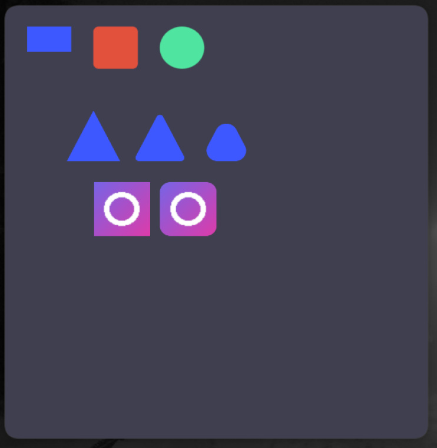

# REngine

**REngine** is a custom graphics engine written in modern C++ using Vulkan.

The project is focused on exploring low-level graphics programming, rendering architecture, and GPU resource management.

## Demo

## Tech Stack

- **C++20**
- **Vulkan 1.3**
- **GLFW**
- **CMake**
- **GLSL / SPIR-V**

## Features

- Vulkan instance and device management
- Rendering pipeline
- Swapchain management
- Texture and image management
- Shader management
- Custom logging system
- Custom mathematical utilities
- Rendering and geometry utilities

## Project Goals

- Build a graphics engine from scratch.
- Understand Vulkan and modern GPU architecture.
- Explore rendering techniques and graphics programming.
- Develop a modular and maintainable engine architecture.

## Status

work in progress.. but now stopped...

**Author:** [recursive17](https://github.com/recursive17)
